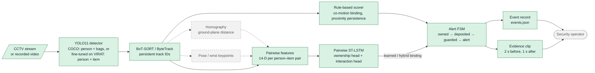
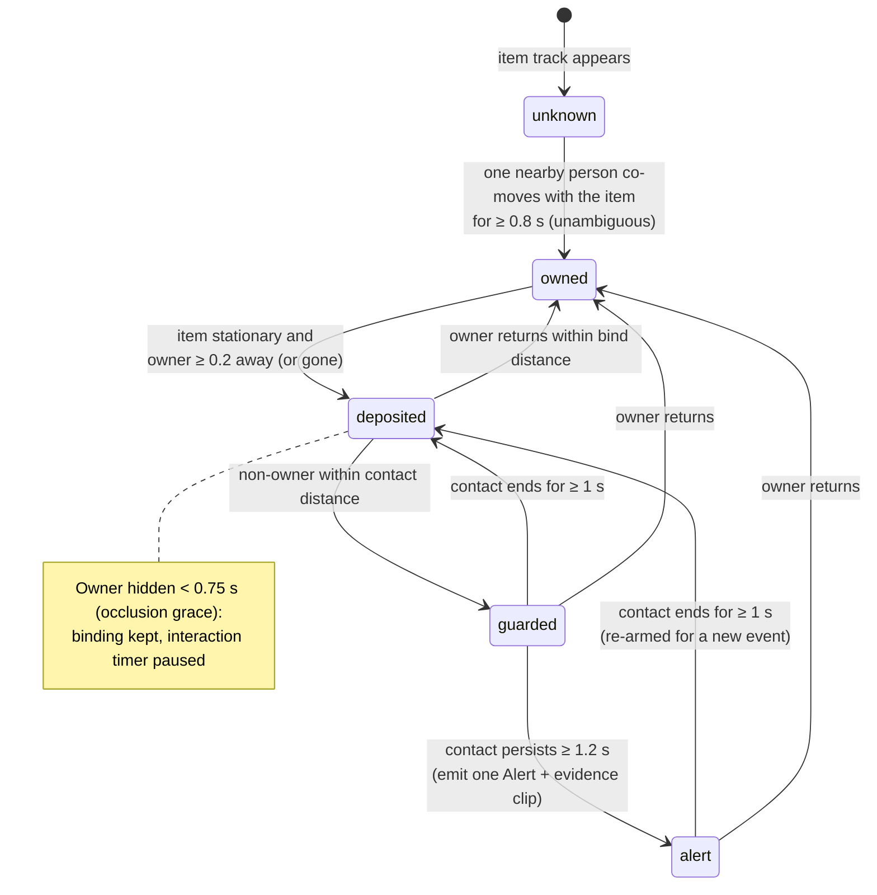
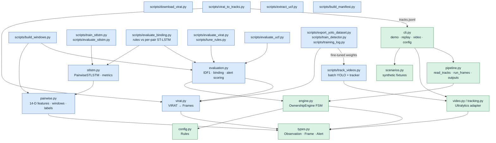
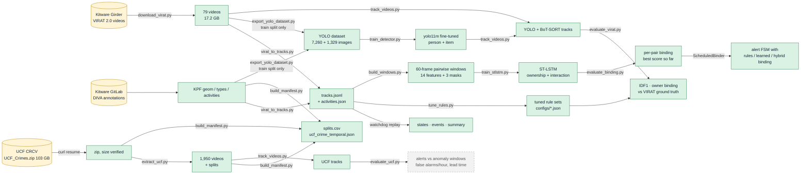

# WatchDog architecture

Diagrams of the planned system (from the project deck) and of what the repository implements today. In the diagrams, **solid green** nodes are implemented and **dashed grey** nodes are planned. GitHub, VS Code (with a Mermaid extension) and most Markdown viewers render these diagrams.

## 1. End-to-end system

The rule-based scorer is the baseline. When the ST-LSTM is ready, it feeds the same FSM, so both can be compared under one alert policy.

## 2. Alert state machine (as implemented in `engine.py`)

Distances are minimum box gaps in normalized image coordinates. All thresholds live in `config.Rules` and can be overridden with `watchdog config > rules.json`.

## 3. Code structure

Blue nodes were added in this session (see [WORKLOG.md](WORKLOG.md)). `tracking.py` also gained `--imgsz`, open-vocabulary `--item-classes` (YOLO-World) and a fix for tracks that change class mid-sequence.

## 4. Data pipeline

UCF tracking is running; the UCF alert scoring is built and tested but not yet run on real tracks.

## 5. Datasets and what each provides

| Dataset | Used for | Labels available | What it doesn't have |
| --- | --- | --- | --- |
| VIRAT Ground 2.0 + DIVA | Owner binding, interaction learning, tracking evaluation | Per-frame person and object boxes with IDs; 40 activity types incl. PickUp, SetDown, Object_Transfer, carrying | Theft events; bags are small and far from the camera |
| UCF-Crime | Anomaly pretraining; alert timing and false-alarm evaluation | Video-level class (13 anomalies + normal); frame windows for the 290 test videos | Boxes or tracks (we generate them with YOLO) |
| PETS 2006 | Planned luggage benchmark | — | Unavailable (hosts offline) |
| Campus footage | Planned fine-tuning | — | Out of scope for now |
