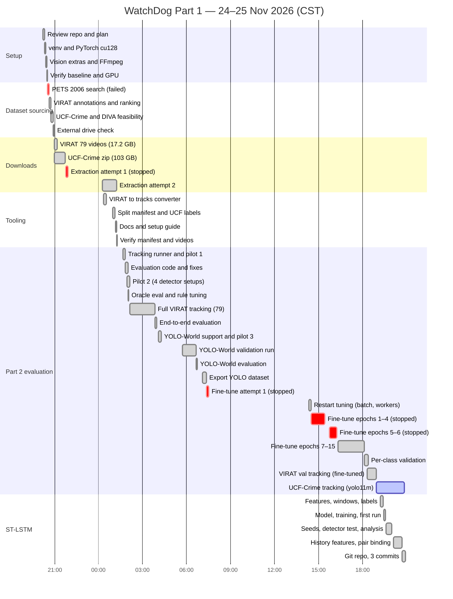

# WatchDog work log

A running record of completed work, with when each step happened and how long it took. Times are local (CST, UTC−6). Durations come from file timestamps and command logs in [`logs/`](logs/). "≈" marks a duration estimated from neighbouring timestamps rather than measured directly.

Owner of this session: Tanvi Patel. Data lives on an external drive at `D:\watchdog-data` (see [SETUP.md](SETUP.md)).

## Status at a glance

| Area | Status |
| --- | --- |
| Environment (Python 3.11, PyTorch CUDA 12.8, Ultralytics, FFmpeg) | ✅ Done, verified on RTX 5060 |
| Synthetic baseline (milestone 1) | ✅ Verified: demo alerts 0/0/0/1, all tests pass |
| PETS 2006 | ❌ Unobtainable: every host is offline |
| VIRAT videos and annotations | ✅ 79 videos (17.2 GB) and both annotation formats |
| VIRAT → `tracks.jsonl` converter | ✅ 79 of 79 converted, replay works |
| UCF-Crime download | ✅ 103 GB zip, size verified |
| UCF-Crime extraction | ✅ 1,981/1,981 entries, all checksums verified (1,950 videos) |
| Split manifest and UCF temporal labels | ✅ Built and verified: 0 problems |
| Filming or staging campus clips | ⏸ Out of scope for now |
| **Part 2:** evaluation tooling (tracking, binding, tuning) | ✅ Built, 25/25 tests pass |
| Part 2: crash on a class change mid-track in `watchdog video` | ✅ Fixed (`tracking.py`) |
| Part 2: rule tuning on ground-truth tracks | ✅ Validation coverage 38% → 62–77% at 100% accuracy, 0 false alarms |
| Part 2: YOLO11m@1280 + BoT-SORT on all 79 VIRAT videos | ✅ Done in 1 h 43 min (≈21 processed FPS) |
| Part 2: end-to-end evaluation on VIRAT | ✅ Person IDF1 0.42 (val) / 0.43 (train); binding coverage 23% (val) with moderate rules, 100% accuracy, 0 false alarms |
| Part 2: item detection on VIRAT | 🔄 YOLO-World tried (recall 6.5%, precision 7%). Option (a): yolo11m fine-tuned on VIRAT person + item boxes, 15 epochs done. Held-out item recall 0.51, precision 0.74 (mAP50 0.56). On the validation split: item recall 35% (was 2.9%), binding 6/13 with moderate rules, 0 false alarms |

## Timeline

## Detailed log

| # | Start | End | Duration | What was done | Result |
| --- | --- | --- | --- | --- | --- |
| 1 | 11-24 20:12 | 20:20 | ≈8 min | Unpacked the repo, read `README.md` and `WatchDog_Project_Context.md`, and checked the tools already installed. Took "part 1" to mean development-plan step 1 (data). | Python 3.11.9, Git 2.52 and an RTX 5060 Laptop GPU found. No FFmpeg. |
| 2 | 20:15 | — | — | Scope decision: no filming or staging; use public datasets instead. | The plan moved to PETS 2006, VIRAT and UCF-Crime. |
| 3 | 20:18 | 20:23 | 5 min | Created `.venv`. Installed `torch`/`torchvision` from the **cu128** index (the RTX 5060 is a Blackwell GPU, so older CUDA builds of PyTorch don't support it). | `torch 2.11.0+cu128`, `cuda.is_available() == True`. |
| 3a | 20:23 | 20:25 | ≈2 min | **Problem:** a pip self-upgrade ran at the same time as the user's torch install and broke pip in the venv. | Fixed with `ensurepip`, and removed the leftover `~ip` folders. Torch was unaffected. |
| 4 | 20:24 | 20:26 | 2 min | `pip install -e ".[vision]"` | Ultralytics 8.4.218, OpenCV 4.14.0, NumPy 2.4.6 and `lap` installed. |
| 5 | — | 20:27 | — | User installed FFmpeg (`winget install Gyan.FFmpeg`). | FFmpeg 9.1. |
| 6 | 20:28 | 20:30 | 2 min | Checked the baseline: `watchdog demo`, `watchdog demo --video`, the unit tests, and YOLO11n on `cuda:0`. | Alerts 0/0/0/1 as expected, 18/18 tests pass, about 15 ms YOLO inference per frame. |
| 7 | 20:30 | 20:38 | ≈8 min | Searched for PETS 2006: the official site, both Reading FTP hosts, the Wayback Machine, ResearchGate and MLDTA. | **Unobtainable.** Every host is offline, and the archived zips are truncated (about 100 MB of each roughly 1 GB file). |
| 8 | 20:38 | 20:45 | ≈7 min | Downloaded the VIRAT Release 2 annotations (41 MB) and ranked the videos by carrying and loading events. | 315 of 329 videos annotated. The top 20 videos are 2.8 GB with 265 carrying events. |
| 9 | 20:45 | 20:53 | ≈8 min | UCF-Crime feasibility: listed the 103 GB zip remotely with HTTP range requests. Downloaded the DIVA VIRAT annotations (194 MB). | UCF-Crime has 1,981 entries in 16 categories. DIVA has 40 activity types, including PickUp, SetDown and Object_Transfer. |
| 10 | 20:55 | 20:59 | ≈4 min | Checked the external drive: WD My Passport, 1.86 TB, NTFS, USB 3. Wrote and read a 2 GB test file. | 1,577 GB free, 69 MB/s sustained write. Moving the repo's `data/` folder onto it was blocked by a safety check, so data goes to `D:\watchdog-data` directly. |
| 11 | 20:59 | 21:11 | **12 min** | `scripts/download_virat.py`: 79 DIVA-annotated videos, 4 at a time, resumable, sizes checked. | 79/79 downloaded, 17.2 GB, no failures. 40 annotated videos were never published (listed in `missing_videos.txt`). |
| 12 | 20:59 | 21:44 | **45 min** | Downloaded `UCF_Crimes.zip` with curl (resume and retries), plus the temporal annotations and instruction file. | 102,957,372,377 bytes, exactly the expected size. The zip opens with 1,981 entries. |
| 13 | 21:45 | (stopped) | — | Extraction attempt 1. | Claude Code stopped it because the system was low on memory, after about 1.1 GB. |
| 14 | 00:16 | 01:14 | **58 min** | Extraction attempt 2: skips finished files, verifies checksums, flushes each file to disk (now `scripts/extract_ucf.py`). | `EXTRACT_OK`: 1,981/1,981 entries (104.9 GB), all checksums verified, 1,950 videos, no `.part` files left. |
| 15 | 00:19 | 00:31 | **12 min** | Wrote `src/watchdog_cctv/virat.py`, `scripts/virat_to_tracks.py` and `tests/test_virat.py`. Converted all videos (stride 2, so 15 FPS) and replayed 3 of them. | 79/79 converted (49 MB), 24 videos with item tracks, 21/21 tests pass. **Engine binding item 114 to owner 83 matches the ground-truth PickUp and carry labels.** |
| 16 | 00:58 | 01:06 | ≈8 min | `scripts/build_manifest.py`: `splits.csv` and `annotations/ucf_crime_temporal.json`. | VIRAT 119 clips (64 train / 55 validation). UCF-Crime 1,900 clips (1,610 train / 290 test). 290 temporal labels, 140 with anomaly windows. |
| 17 | 01:09 | 01:14 | ≈5 min | This `docs/` folder: work log, setup guide, architecture diagrams, logs and the pip lock file. Also turned the extraction into `scripts/extract_ucf.py`. | — |
| 18 | 01:14:34 | 01:14:52 | **18 s** | `build_manifest.py --verify`: checked every video's existence and size, and read the FPS of each UCF test video. | **0 problems.** All 79 VIRAT and 1,900 UCF-Crime split videos are present at the expected sizes. All 290 test videos are 30 FPS, so anomaly windows now have seconds too (e.g. `Stealing019`: 91.0–93.0 s and 139.0–145.0 s). |

The gap between 21:45 and 00:16 was idle time between sessions.

### Part 2: run the pipeline and measure (README development-plan step 2)

| # | Start | End | Duration | What was done | Result |
| --- | --- | --- | --- | --- | --- |
| 19 | 01:40 | 01:49 | ≈9 min | Installed `motmetrics` 1.4.0 (new `eval` extra). Wrote `scripts/track_videos.py`, which saves tracks only and is resumable. Pilot 1: yolo11n/s/m at 640 on 2 validation clips. | 15–21 processed frames/s, about real time. |
| 20 | 01:50 | 01:59 | ≈9 min | Wrote `src/watchdog_cctv/evaluation.py` (IDF1/MOTA via motmetrics, ID mapping, owner-binding scoring) and `scripts/evaluate_virat.py`. Two fixes: (a) motmetrics' IoU helper uses `numpy.asfarray`, removed in NumPy 2, so we compute IoU ourselves; (b) **bug in the existing pipeline: BoT-SORT can change a track's class mid-sequence, which crashed the engine (`track 193 changed kind`).** Fixed in `tracking.py`: a class change continues under ID + 1,000,000. Added `--imgsz`. | 25/25 tests pass, 4 new. Overlaying ground truth on a frame confirmed the alignment; low recall comes from small, occluded people. |
| 21 | 01:56 | 02:07 | 11 min | Pilot 2, after the fix: yolo11n@640, n@1280, s@1280, m@1280. | **yolo11m@1280 is best**: person IDF1 0.32 (default 0.07), recall 34%, about 22 processed FPS. **Item recall is at most 2.4%**: VIRAT props (boxes, carts, assorted bags) are tiny and mostly not COCO backpack, handbag or suitcase. |
| 22 | 02:00 | 02:01 | ≈1 min | Oracle evaluation: the rules engine on ground-truth tracks, all 79 clips. | Default rules: coverage 37% (train) / 38% (validation), **owner accuracy 100%, 0 false alarms in 2.4 h**. |
| 23 | 02:01 | 02:03 | 34 s + ≈1 min | `scripts/tune_rules.py`: 54 + 108 grid candidates on train, best checked on validation. | Moderate set (`configs/rules_virat_moderate.json`): validation coverage 62%, accuracy 100%. Aggressive set (`configs/rules_virat_aggressive.json`): 77%, 100%, but 0.1 direction threshold and 0.2 s binding, so overfitting risk. 0 alerts for both. |
| 24 | 02:07 | 03:50 | 1 h 43 min | `track_videos.py` with yolo11m@1280 + BoT-SORT on all 79 VIRAT videos (2.67 h of footage), validation first. Output: `D:\watchdog-data\tracks\virat_yolo11m_1280_botsort`. | 79/79 clips, ≈21 processed FPS (≈42 source FPS), faster than real time at 15 FPS. |
| 25 | 03:50 | 03:58 | ≈8 min | End-to-end evaluation (`evaluate_virat.py`), both splits × default / moderate / aggressive rules. Fixed two crashes on a train clip that annotates only vehicles (`tracking_metrics` now returns empty; per-clip line skips IDF1). Reports: `logs/{validation,train}_yolo11m_1280_*.json`. | See the results table below. 25/25 tests still pass. |
| 26 | 04:05 | 04:17 | ≈12 min | Option (b): open-vocabulary items. Added `item_classes` to `UltralyticsTracker` (calls `set_classes`; every non-person prompt is an item), `--item-classes` to `watchdog video` and `track_videos.py`. Ultralytics auto-installed `clip` (from GitHub) and downloaded `yolov8l-worldv2.pt` (338 MB). Pilot 3 on the two pilot clips, prompts `backpack handbag suitcase bag box cart`, moderate rules. | See the pilot 3 table below. |
| 27 | 04:17 | 06:39 | 56 min compute (2 h 22 min wall) | YOLO-World-L @1280, conf 0.1, on the full validation split. Output: `tracks/virat_yolov8l-worldv2_1280_c0.1_botsort`. The first clip did not start until ≈05:42; the log gives no reason for the 85-minute delay (possibly the laptop or drive sleeping). | 34/34 clips, 16.7 processed FPS. |
| 28 | 06:39 | 06:44 | ≈5 min | Evaluated the YOLO-World validation tracks with default, moderate and aggressive rules. Reports: `logs/validation_yolov8l-worldv2_1280_c0.1_*.json`. | See the comparison table below. |
| 29 | 07:05 | 07:20 | ≈15 min (export 5 min 19 s) | Option (a). Checked label completeness: only 2.3% of yolo11m person detections with confidence ≥ 0.6 have no DIVA person box (IoU < 0.3), so no pseudo-labels are needed. Wrote `scripts/export_yolo_dataset.py` (train split only; frames with items every 6th frame, others every 30th; every 5th clip held out as YOLO val, separately for clips with and without items), `scripts/train_detector.py`, and a test. The tracker now also accepts a class named `item`. Dataset: `D:\watchdog-data\yolo\virat_person_item`. | Train 7,260 images (25,862 person, 4,115 item boxes, 35 clips); held-out val 1,329 images (4,643 / 673, 8 clips). VIRAT validation split untouched. 26/26 tests pass. |
| 30 | 07:20 | stopped | — | `train_detector.py`: yolo11m (COCO) → person + item, imgsz 1280, batch 4, 4 data-loader workers, 30 epochs, patience 8. Output: `D:\watchdog-data\runs\detect\virat_person_item`. Claude Code stopped it during epoch 1 because system RAM ran low (16 GB laptop; on Windows each data-loader worker loads its own copy of PyTorch). No checkpoint was saved, so it has to start again from scratch. | Restarted after the user approved (see 31). |
| 31 | 14:20 | 14:29 | ≈9 min | Restart tuning. (1) `--workers 1`, batch 4: 1.2 s per batch, **8.05 of 8.15 GB VRAM**, so Windows spilled GPU memory into system RAM (97% commit, 1.3 GB free); 30 epochs would take ≈18 h. Stopped after 3 min. (2) Batch 2: 4.8 GB VRAM, 5.5 batches/s (≈11 images/s), ≈12.5 min per epoch, 30 epochs ≈6.3 h. Stopped after 2 min at the user's request. Ultralytics accumulates gradients to a nominal batch of 64, so the smaller batch keeps the effective batch size. | Final settings: batch 2, 1 worker, 15 epochs. |
| 32 | 14:29 | 18:06 | 3 h 37 min wall (≈2 h 55 min training; 2 stops) | `train_detector.py --epochs 15 --batch 2 --workers 1 --name virat_person_item_e15`. Log: `D:\watchdog-data\runs\train_virat_person_item_e15.log`. **Per-epoch metrics: [logs/training_virat_person_item_e15.md](logs/training_virat_person_item_e15.md)**, regenerated after every epoch by `scripts/training_log.py`. | Epoch 1 (13.5 min): precision 0.73, recall 0.42, mAP50 0.48, mAP50-95 0.20. Best so far, epoch 4: 0.78 / 0.57 / 0.64 / 0.31. **Claude Code stopped the run at ≈15:25, partway through epoch 5, for low system RAM** (other apps such as Discord were open). The epoch-4 checkpoint `weights/last.pt` is saved, so it can resume with `--resume`. Resumed at 15:45 (epochs 5–6 done; best epoch 5: 0.83 / 0.55 / 0.64 / 0.32). **Stopped again for low RAM at ≈16:14, partway through epoch 7**, although other apps were closed and 7.7 GB was free afterwards. The epoch-6 `last.pt` is saved. Resumed at 16:18 in the user's own terminal (outside Claude Code's background-job memory check) and finished all 15 epochs at 18:06 with no further stops. **Best checkpoint: epoch 11** (precision 0.80, recall 0.63, mAP50 0.695, mAP50-95 0.345), copied to `weights/yolo11m_virat_person_item.pt`. Curves: `logs/training_virat_person_item_e15_results.png`. |
| 34 | 18:07 | 18:22 | ≈15 min | Per-class validation of the best checkpoint on the held-out clips (`logs/val_best_per_class.log`). The first attempt hung: a data-loader worker cannot start when the script is piped through stdin on Windows; rerun with `workers=0`. | **Person** P 0.87, R 0.76, mAP50 0.83, mAP50-95 0.40. **Item** P 0.74, R 0.51, mAP50 0.56, mAP50-95 0.29 (673 item boxes, 490 images). 23 ms per image at 1280. |
| 35 | 18:18 | 18:56 | 37 min | `track_videos.py` with the fine-tuned detector on the 34 VIRAT validation clips (output `D:\watchdog-data\tracks\virat_yolo11m-ft-e15_1280_botsort`), then `evaluate_virat.py` with default / moderate / aggressive rules. Reports: `logs/validation_yolo11m-ft-e15_1280_*.json`. | ≈25 processed FPS. **Item recall 2.9% → 35.3%, precision 23% → 67%; moderate-rule binding 3/13 → 6/13 with 0 false alarms.** See the comparison table below. |
| 37 | 19:12 | 19:24 | ≈12 min | **ST-LSTM step 1: pairwise features, windows and labels** (README dev-plan step 3), on CPU while UCF tracking runs. New `src/watchdog_cctv/pairwise.py`, `scripts/build_windows.py`, `tests/test_pairwise.py` (6 tests). Feature schema agreed with the user (see "ST-LSTM input schema" below); `wrist_distance` = 0 with `pose_available` = 0 until pose is added as an ablation. Built windows from DIVA ground-truth tracks at 15 FPS: `D:\watchdog-data\windows\virat_gt_{train,validation}.npz` (+ `.json`). | Train: 971 windows from 43 clips (ownership 375 positive / 516 negative / 80 ignored; interaction none 694, carry 215, load_unload 39, handle 23). Validation: 260 windows from 34 clips (191 / 63 / 6; none 94, carry 126, load_unload 13, handle 27). No NaNs, 98.8% of frames have both boxes. 33/33 tests pass. Built in 26 s. |
| 38 | 19:26 | 19:33 | ≈7 min (training 12.6 s on CPU) | **ST-LSTM model and training.** User installed scikit-learn 1.9.1 (new `stlstm` extra; lock file refreshed). New `src/watchdog_cctv/stlstm.py` (BiLSTM, 12 standardized features + 3 masks → embed 64 → BiLSTM 64 → ownership logit + 4-way interaction logits; scikit-learn metrics), `scripts/train_stlstm.py` (AdamW 1e-3, weight decay 1e-2, cosine annealing, pos-weighted BCE + sqrt-inverse-frequency CE, early stopping on held-out train clips, box-gap rule and majority baselines), `tests/test_stlstm.py` (5 tests). First run on ground-truth windows: `D:\watchdog-data\runs\stlstm\baseline_gt`. | 38/38 tests pass. Best epoch 13 of 28. See "ST-LSTM baseline results" below. |
| 39 | 19:36 | 20:00 | ≈24 min (5 seeds trained in 2 min 36 s) | **ST-LSTM: detector-track test, threshold tuning, 5 seeds.** Built validation windows from the fine-tuned detector's tracks (`windows/virat_ft_validation`, labels via the predicted → ground-truth ID mapping). Added `stlstm.best_threshold` (F1-optimal cut-off on the selection clips, stored in `model.pt`), `scripts/evaluate_stlstm.py` (mean ± std over runs plus the gap rule on any window sets), 1 test. Trained seeds 0–4 (`runs/stlstm/gt_seed{0..4}`). Diagnosed missed owners and scored ownership per pair. | 39/39 tests pass. See "ST-LSTM: seeds, detector tracks, per-pair" below. |
| 40 | 20:05 | 20:40 | ≈35 min | **ST-LSTM (a) history features + (b) per-pair binding**, approved by the user. (a) Two causal pair-history features appended to the schema (14 total): `comotion_seconds`, `since_comotion`; windows rebuilt as `windows/virat_*_v2`; 5 seeds retrained (`runs/stlstm/hist_seed{0..4}`). (b) `stlstm.pair_scores` + `stlstm.bind_owners`: score every candidate pair every 15 frames, keep each pair's best score so far, bind an item once a pair reaches the run's threshold (highest score wins, binding kept); `scripts/evaluate_binding.py` scores it with the same `score_bindings` as the rules. A test caught a same-timestamp ordering bug in `bind_owners` (fixed: all scores at a time are updated before binding). Older 12-feature models still load (they read the first 12 columns). | 43/43 tests pass. See "ST-LSTM with history features and per-pair binding" below. |
| 41 | 20:40 | 20:55 | ≈15 min | **Git.** `git init`; `.gitattributes` (LF in the repo); three commits, each tested in an isolated worktree: `b3ab079` pre-LSTM (27 tests), `f4104b0` ST-LSTM baseline (39 tests), then the history features, per-pair binding and docs. `data/`, `weights/`, `runs/` and `*.pt` stay ignored (VIRAT agreement). | GitHub remote pending: `gh` is not installed. |
| 36 | 18:56 | running | ≈1–1½ h (est.) | `track_videos.py` on UCF-Crime test videos: Stealing, Shoplifting, Robbery, Burglary and Normal (194 videos, 7.7 h), yolo11m COCO at imgsz 640. Output: `D:\watchdog-data\tracks\ucf_crime_yolo11m_640_botsort`. | — |
| 33 | 14:40 | 14:55 | ≈15 min | UCF-Crime alert evaluation tooling, written while the GPU trains: `evaluation.score_alerts` (alert ↔ anomaly window matching with tolerance, lead time = window end − first alert, delay = first alert − window start), `scripts/evaluate_ucf.py` (theft and normal summaries, per category, false alerts per hour outside windows), `--categories` for `track_videos.py`, 1 test. Evaluation set: test-split Stealing 5, Shoplifting 21, Robbery 5, Burglary 13 (1.67 h, 18.5 min of labelled windows) and Normal 150 (6.0 h). All 320×240. | 27/27 tests pass; smoke test on dummy tracks OK. Detection waits for training to free the GPU (≈2–2½ h at imgsz 640). |

### Fine-tuning progress: yolo11m → person + item (run `virat_person_item_e15`)

Updated automatically after every epoch.

<!-- training:virat_person_item_e15 start -->
Source: `D:/watchdog-data/runs/detect/virat_person_item_e15/results.csv`. Updated 2026-11-25 18:05 after epoch 15 of 15.

Metrics are on the YOLO val clips held out from the VIRAT train split, for persons and items together. Elapsed is wall time since the run started. Ultralytics keeps the checkpoint with the best fitness (mostly mAP50-95) as `best.pt`.

| Epoch | Elapsed | Box loss | Class loss | Precision | Recall | mAP50 | mAP50-95 | Val box loss | Val class loss |
| --- | --- | --- | --- | --- | --- | --- | --- | --- | --- |
| 1 | 0:13:30 | 1.716 | 1.197 | 0.726 | 0.420 | 0.477 | 0.204 | 2.311 | 1.862 |
| 2 | 0:26:33 | 1.659 | 1.091 | 0.790 | 0.538 | 0.597 | 0.288 | 1.826 | 2.016 |
| 3 | 0:38:35 | 1.602 | 1.022 | 0.710 | 0.520 | 0.539 | 0.243 | 2.021 | 2.466 |
| 4 | 0:50:36 | 1.570 | 0.971 | 0.782 | 0.572 | 0.635 | 0.307 | 1.824 | 2.233 |
| 5 | 0:12:17 | 1.511 | 0.911 | 0.826 | 0.554 | 0.642 | 0.322 | 1.868 | 1.698 |
| 6 | 0:24:03 | 1.563 | 0.919 | 0.821 | 0.539 | 0.606 | 0.293 | 1.846 | 1.443 |
| 7 | 0:11:54 | 1.519 | 0.882 | 0.805 | 0.562 | 0.622 | 0.303 | 1.897 | 1.345 |
| 8 | 0:23:24 | 1.496 | 0.860 | 0.902 | 0.539 | 0.643 | 0.303 | 1.879 | 1.622 |
| 9 | 0:34:58 | 1.457 | 0.820 | 0.816 | 0.587 | 0.658 | 0.321 | 1.891 | 1.207 |
| 10 | 0:46:45 | 1.416 | 0.788 | 0.824 | 0.620 | 0.683 | 0.322 | 1.907 | 1.330 |
| **11** | **0:58:33** | **1.393** | **0.774** | **0.802** | **0.631** | **0.695** | **0.345** | **1.801** | **1.117** |
| 12 | 1:10:34 | 1.350 | 0.749 | 0.881 | 0.609 | 0.691 | 0.330 | 1.840 | 1.262 |
| 13 | 1:22:30 | 1.315 | 0.712 | 0.845 | 0.620 | 0.678 | 0.315 | 1.924 | 1.126 |
| 14 | 1:34:28 | 1.281 | 0.680 | 0.812 | 0.647 | 0.698 | 0.327 | 1.851 | 1.098 |
| 15 | 1:46:16 | 1.255 | 0.652 | 0.849 | 0.620 | 0.686 | 0.310 | 1.893 | 1.051 |
<!-- training:virat_person_item_e15 end -->

### Part 2 results (VIRAT, yolo11m@1280 + BoT-SORT, 15 FPS)

| Split | Person IDF1 | Person recall / precision | Person ID switches | Item recall |
| --- | --- | --- | --- | --- |
| Validation (34 clips, 1.0 h) | 0.415 | 44.6% / 67.0% | 387 | 2.9% |
| Train (45 clips, 1.6 h) | 0.426 | 49.2% / 71.8% | 621 | 2.9% |

Owner binding: items correctly bound / items with a ground-truth owner. Oracle = rules on ground-truth tracks; end-to-end = rules on detector tracks.

| Rules | Val oracle | Val end-to-end | Train oracle | Train end-to-end | False alarms (2.7 h) |
| --- | --- | --- | --- | --- | --- |
| Default | 5/13 (38%) | 0/13 (0%) | 13/35 (37%) | 1/35 (3%) | 0 |
| Moderate | 8/13 (62%) | 3/13 (23%) | 20/35 (57%) | 3/35 (9%) | 0 |
| Aggressive | 10/13 (77%) | 3/13 (23%) | 23/35 (66%) | 3/35 (9%) | 0 |

Every binding that could be judged named the correct owner (accuracy 100%, except 20/21 for moderate on the train oracle). Unjudged bindings, where a predicted track maps to no annotated item, rise with looser rules: 6 → 11 on validation, 13 → 34 on train. On predicted tracks the aggressive set gains nothing over moderate and makes 2–3× more unjudged bindings, so **moderate is the recommended rule set**. The gap between oracle and end-to-end is almost entirely item detection.

### Pilot 3: open-vocabulary item detection (2 validation clips, 4 owned items, moderate rules)

| Setup | Person IDF1 | Item recall / precision | Owners bound correctly | Processed FPS |
| --- | --- | --- | --- | --- |
| yolo11m@1280 (COCO classes) | 0.32 | 2.4% / 51% | 1/4 | ≈22 |
| YOLO-World-S @1280, conf 0.1 | 0.31 | 1.2% / 33% | 0/4 | ≈29 |
| YOLO-World-L @1280, conf 0.25 | 0.33 | 7.4% / 37% | 2/4 | ≈15 |
| **YOLO-World-L @1280, conf 0.1** | 0.33 | **9.9%** / 33% | **2/4** | ≈16 |

YOLO-World-L detects about four times as many items with no training and no loss in person tracking, at roughly real time for 15 FPS processing. Item recall is still under 10%, so fine-tuning (option a) remains the fallback.

**Decision (25 Nov, 04:05):** the user chose option (b), YOLO-World, first. **Decision (25 Nov, ≈07:00):** after the YOLO-World results, the user chose option (a), fine-tuning.

### Item detection: all three detectors on the VIRAT validation split (34 clips, 1.0 h, 13 owned items)

The fine-tuned model never saw the validation split; it was trained on 35 train clips and its checkpoint was chosen on 8 others.

| Metric | yolo11m@1280 (COCO) | YOLO-World-L @1280, conf 0.1 | **yolo11m fine-tuned on VIRAT @1280** |
| --- | --- | --- | --- |
| Person IDF1 / recall / precision | 0.415 / 44.6% / 67.0% | 0.453 / 51.8% / 59.3% | **0.600 / 71.7% / 74.9%** |
| Item IDF1 / recall / precision | 0.035 / 2.9% / 23.0% | 0.044 / 6.5% / 7.1% | **0.368 / 35.3% / 67.4%** |
| Binding, default rules | 0/13 (2 unjudged) | 3/13 (14 unjudged) | **4/13 (0 unjudged)** |
| Binding, moderate rules | 3/13 (6 unjudged) | 4/13 (43 unjudged) | **6/13 (3 unjudged)** |
| Binding, aggressive rules | 3/13 (11 unjudged) | 6/13 (76 unjudged), 1 false alert | **7/13 (8 unjudged)** |
| False alerts (1.0 h) | 0 | 1 | **0** |
| Processed FPS | ≈21 | ≈17 | **≈25** |

Every judged binding names the correct owner. With moderate rules, end-to-end binding (6/13) is now close to the ground-truth-track ceiling (8/13 oracle), so the remaining gap is mostly the rules, not detection. **The fine-tuned detector is the new default for VIRAT-style footage.**

### YOLO-World vs yolo11m on the full validation split (34 clips, 1.0 h, 13 owned items)

| Metric | yolo11m@1280 | YOLO-World-L @1280, conf 0.1 |
| --- | --- | --- |
| Person IDF1 / recall / precision | 0.415 / 44.6% / 67.0% | **0.453** / 51.8% / 59.3% |
| Item recall / precision | 2.9% / 23.0% | **6.5%** / 7.1% |
| Binding, default rules | 0/13 (2 unjudged) | 3/13 (14 unjudged) |
| Binding, moderate rules | 3/13 (6 unjudged) | 4/13 (43 unjudged) |
| Binding, aggressive rules | 3/13 (11 unjudged) | 6/13 (76 unjudged), **1 false alert** |
| Processed FPS | ≈21 | ≈17 |

Every judged binding names the correct owner. YOLO-World improves person tracking and finds twice as many items, but more than 90% of its item detections match no annotated item, so unjudged bindings rise 7×. Some may be real but unannotated objects; most are probably false detections. That noise produced the first false alert on VIRAT. Conclusion: prompts alone are not enough; fine-tuning on VIRAT item boxes (option a) is the stronger next step.

**Earlier decision point:** item detection. Options: (a) fine-tune YOLO on VIRAT `Prop`/`Push_Pulled_Object` boxes from the train split; (b) try an open-vocabulary detector (YOLO-World with prompts such as "bag", "box", "cart"); (c) accept that end-to-end binding on VIRAT is limited by detection and evaluate items on UCF-Crime instead.

### ST-LSTM input schema (agreed 25 Nov, 19:12)

Per frame, per person–item pair. Distances are image-space (normalized box coordinates ÷ the person's box height); speeds are person heights per second. Values are clipped to ±10 and set to 0 where an input is missing.

| # | Feature | Definition |
| --- | --- | --- |
| 1–2 | `dx`, `dy` | Item center minus person center |
| 3 | `box_gap` | Minimum gap between the boxes (the rules engine's distance) |
| 4 | `center_distance` | Distance between centers |
| 5 | `iou` | Box intersection over union |
| 6 | `person_speed` | From the previous visible sample within 0.5 s |
| 7 | `item_speed` | Same, for the item |
| 8 | `velocity_cosine` | Cosine of the two velocities; 0 unless both move faster than 0.05 heights/s |
| 9 | `relative_speed` | Magnitude of the velocity difference |
| 10 | `item_displacement` | Item's distance from where it was first seen in the clip |
| 11 | `wrist_distance` | Placeholder: always 0 until pose is added (ablation) |
| 12 | `copresence_seconds` | Time since the pair was first visible together, capped at 10 s, ÷ 10 |

Masks (separate from the 12): `person_visible`, `item_visible`, `pose_available` (always 0 for now).

Windows: 60 frames at 15 FPS (4 s), hop 30 (50% overlap). Candidate pairs: the boxes come within 0.1 (normalized image units) at least once. Splits are whole clips from `splits.csv`.

Labels (from DIVA): **ownership** = 1 if the person is an annotated actor with the item in an owner activity (same definition as the binding evaluation), 0 for other people near an owned item, −1 (ignore) when the item has no annotated owner. **Interaction** at the window's last frame: `none`, `carry` (Transport_HeavyCarry, Pull, Push), `load_unload` (Loading, Unloading), `handle` (PickUp, SetDown, Drop, Interacts). The deck's pickup / set-down / transfer split is not learnable from VIRAT: PickUp, SetDown and Drop have only 11 instances (≈16 s), and Object_Transfer and activity_carrying never involve an annotated item.

Train-set feature means (frames with both boxes), owner vs non-owner: `box_gap` 0.005 vs 2.91, `iou` 0.20 vs 0.02, `velocity_cosine` 0.33 vs 0.05, `dx` −0.02 vs 2.38. Most negatives are far-away people, so they are easy; hard negatives (a stranger next to the bag) are rare in VIRAT.

### ST-LSTM baseline results (ground-truth windows, run `baseline_gt`)

Trained on 880 windows from 35 train clips; checkpoint chosen on 91 windows from the 8 held-out train clips (the same clips held out for the detector); tested once on the 260 VIRAT validation windows. Threshold 0.5 for the LSTM; the gap rule's threshold (mean gap ≤ 0.0056 person heights) was tuned on the training clips.

| Ownership (254 test windows, 191 owner) | AUROC | F1 | Precision | Recall |
| --- | --- | --- | --- | --- |
| Box-gap rule | 0.948 | **0.947** | 0.962 | **0.932** |
| ST-LSTM | **0.973** | 0.886 | **0.969** | 0.817 |

| Interaction (260 test windows) | Macro-F1 | none | carry | load_unload | handle |
| --- | --- | --- | --- | --- | --- |
| Majority class (none) | 0.133 | — | — | — | — |
| ST-LSTM | **0.432** | 0.707 | 0.689 | 0.333 | 0.000 |
| Support | | 94 | 126 | 13 | 27 |

Reading: the LSTM ranks owners better than the rule (AUROC 0.973 vs 0.948) but its fixed 0.5 threshold misses more owners, so F1 is lower; the threshold should be calibrated on the selection clips. On ground-truth boxes, owners almost always touch their item, which makes the gap rule unusually strong; detector tracks (noisier boxes, gaps, ID switches) are the more realistic test. Interaction: carry vs none is learned; `handle` (23 training windows) is never predicted, and 42 of 126 carry windows are called `none`.

### ST-LSTM: seeds, detector tracks, per-pair (5 seeds, trained on ground-truth windows)

Test windows: `gt` = 260 windows from ground-truth tracks; `ft` = 183 windows from the fine-tuned detector's tracks (79 owner, 62 non-owner, 42 ignored because the item was not matched). ST-LSTM thresholds are tuned per seed on the selection clips (0.43–0.67).

| Ownership, per window | AUROC | F1 | Precision | Recall |
| --- | --- | --- | --- | --- |
| gt: ST-LSTM (mean ± std) | **0.978 ± 0.003** | 0.886 ± 0.017 | **0.979** | 0.809 |
| gt: gap rule | 0.948 | **0.947** | 0.962 | **0.932** |
| ft: ST-LSTM | **0.974 ± 0.005** | 0.832 ± 0.089 | **0.947** | 0.752 |
| ft: gap rule | 0.956 | **0.923** | 0.935 | **0.911** |

| Interaction macro-F1 | gt | ft |
| --- | --- | --- |
| ST-LSTM | 0.430 ± 0.029 | 0.433 ± 0.071 |
| (per class, gt) | none 0.70, carry 0.69, load_unload 0.30, handle 0.03 | none 0.78, carry 0.78, load_unload 0.04, handle 0.13 |

Findings:

1. **The ST-LSTM ranks owners better on every seed and on detector tracks** (AUROC 0.97–0.98 vs 0.95–0.96), with little seed-to-seed spread.
2. **At its chosen threshold it misses ≈20% of owner windows, so window-level F1 trails the rule.** Tuning the threshold on all training windows instead of the 91 selection windows does not fix it (F1 0.889 gt, 0.794 ft).
3. **Cause: stationary owners.** The 41 missed owner windows (seed 0) touch the item (median gap 0) but barely move (person speed 0.007 vs 0.17 heights/s for found owners; velocity cosine 0.01 vs 0.37). The model learned "owner = moves with the item". 28 of the 41 come from one clip (`VIRAT_S_040103_01_000132_000195`).
4. **Per pair (max score over the pair's windows), which is what the FSM needs** since it keeps a binding once made: gt 26 pairs, ST-LSTM F1 0.903 (AUROC 0.966) = rule F1 0.903 (AUROC 0.941); ft 23 pairs, ST-LSTM F1 0.954 ± 0.028 (AUROC 0.967) vs rule 0.933 (AUROC 0.933). With 23–26 pairs this is a tie within noise, not a win.
5. Interaction stays weak on the rare classes (`load_unload`, `handle`).

### ST-LSTM with history features and per-pair binding (25 Nov, 20:05–20:40)

**Schema change (approved by the user):** two causal pair-history features appended as #13–14, so ownership evidence persists after a pair stops moving together. A frame counts as co-motion when both move faster than 0.05 heights/s, velocity cosine ≥ 0.7 and box gap ≤ 0.5 heights.

| # | Feature | Definition |
| --- | --- | --- |
| 13 | `comotion_seconds` | Total co-motion time so far in the clip, capped at 10 s, ÷ 10 |
| 14 | `since_comotion` | Seconds since the last co-motion frame, capped at 30 s, ÷ 30 (1 if none yet) |

Both keep their value while a box is briefly missing. Every feature is causal (a test checks that features of a clip prefix equal the prefix of the full clip's features).

**Per window, 5 seeds each (mean ± std):**

| Ownership F1 | gt windows | ft (detector) windows |
| --- | --- | --- |
| Box-gap rule | 0.947 | 0.923 |
| ST-LSTM, 12 features | 0.886 ± 0.017 | 0.832 ± 0.089 |
| **ST-LSTM, 14 features** | 0.936 ± 0.032 | **0.984 ± 0.012** |

| Other metrics, 14 features | gt | ft |
| --- | --- | --- |
| Ownership AUROC | 0.996 ± 0.001 (rule 0.948) | 0.995 ± 0.003 (rule 0.956) |
| Ownership precision / recall | 1.000 / 0.882 | 0.980 / 0.987 |
| Interaction macro-F1 | 0.502 ± 0.065 (was 0.430) | 0.578 ± 0.084 (was 0.433) |

**Per-pair binding on the 34 validation clips (13 owned items), scored like the rules:**

| Owners bound correctly | Rules (moderate) | ST-LSTM 12 features | ST-LSTM 14 features |
| --- | --- | --- | --- |
| Ground-truth tracks | 8/13 (3 unjudged) | **12/13** on all 5 seeds (2.8 unjudged) | **12/13** on all 5 seeds (3 unjudged) |
| Fine-tuned detector tracks | 6/13 (3 unjudged) | 6.8 ± 0.4 (12 ± 2.5 unjudged) | **7/13** on all 5 seeds (13.2 ± 0.8 unjudged) |

Reading:

1. **The history features fix the stationary-owner problem at window level:** detector-track F1 rises from 0.83 to 0.98 and now clearly beats the rule (0.92); recall goes from 0.75 to 0.99.
2. **Per-pair binding with best-so-far scores beats the rules engine:** 12/13 vs 8/13 on ground-truth tracks and 7/13 vs 6/13 on detector tracks, with every judged binding correct. Best-so-far already gives per-pair memory, so at pair level the 12- and 14-feature models are close; the history features mainly make the per-window scores (and seeds) consistent.
3. **Caveat: more unjudged bindings on detector tracks** (≈13 vs 3 for the rules): the LSTM binds people to detected items that have no DIVA annotation. Some are real bags DIVA did not label, some are false detections; they cannot be scored as right or wrong, and the rules are more conservative. A higher binding threshold or a minimum item-track length would trade some coverage for fewer of these.
4. Still small samples (13 owned items, 183–260 windows); results are consistent across seeds but need more data before strong claims.

## Decisions and why

| Decision | Why |
| --- | --- |
| Public datasets only, no filming | Filming is out of scope for now; it may come back later if time permits. |
| VIRAT as the main dataset for owner–item work | It has real surveillance footage with person and object box tracks, plus PickUp, SetDown and Object_Transfer labels. |
| UCF-Crime for anomaly pretraining and alert evaluation | It has 1,900 real CCTV videos in 13 anomaly categories, including Stealing and Shoplifting, with temporal labels on the test set. |
| Full UCF-Crime zip rather than a 16 GB subset | Once the 1.86 TB drive was connected, space was no longer a constraint, and the normal training videos are needed for weakly supervised training. |
| `--stride 2` for VIRAT tracks | VIRAT is about 30 FPS; the deck's windows are 60 frames at 15 FPS. |
| DIVA items = `Prop` and `Push_Pulled_Object` | Those are the object types involved in PickUp, SetDown and Object_Transfer. `Other` is a catch-all and can be added with `--item-types`. |

## Open items

- [x] Finish the UCF-Crime extraction and run `build_manifest.py --verify` (done 01:14, 0 problems).
- [ ] Optionally delete `UCF_Crimes.zip` (103 GB) once the check passes.
- [ ] Teammates accept the VIRAT usage agreement before using the data.
- [x] Put the repo under git (3 commits on `main`).
- [ ] Create the GitHub repository and push (needs `gh` or an empty repo URL from the user).
- [x] Run YOLO11 and BoT-SORT on VIRAT and measure IDF1 and owner-binding accuracy against ground truth; tune thresholds (done; see Part 2).
- [x] Improve item detection (done: fine-tuned yolo11m, item recall 2.9% → 35% on validation).
- [ ] UCF-Crime alert evaluation: tracking running, then `evaluate_ucf.py`.
- [ ] Optional: re-tune rules on fine-tuned-detector tracks; try the fine-tuned detector on UCF-Crime.
- [x] ST-LSTM on 60-frame pairwise windows: baseline, history features, per-pair binding (done).
- [ ] ST-LSTM: plug per-pair binding into the alert FSM and score alerts on UCF-Crime; reduce unjudged bindings; pose ablation.
